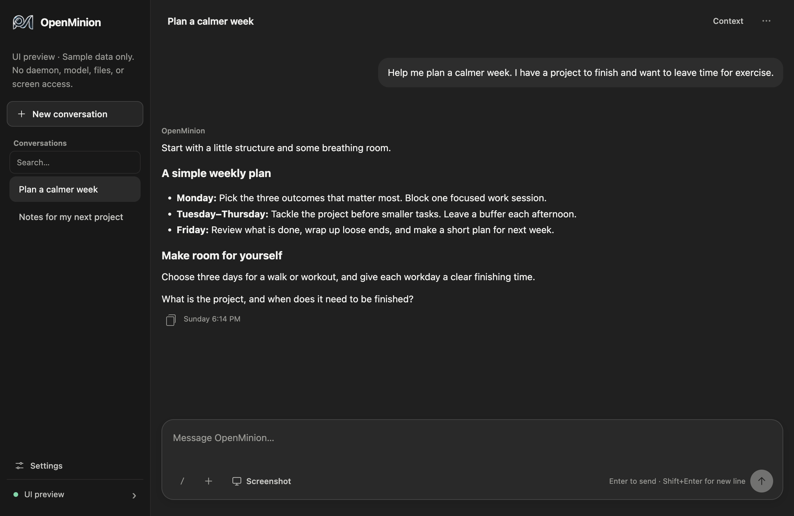

<p align="center">
  <a href="https://www.openminion.com"></a>
</p>

<h1 align="center">OpenMinion Desktop</h1>

<p align="center">
  <strong>Chat, manage agents, and review their work in one local desktop app.</strong>
</p>

<p align="center">
  <a href="#install">Download</a>
  · <a href="docs/README.md">Docs</a>
  · <a href="CONTRIBUTING.md">Contribute</a>
  · <a href="https://github.com/openminion/openminion">CLI &amp; Core</a>
  · <a href="https://www.openminion.com">Website</a>
  · <a href="https://x.com/OpenMinion">X</a>
</p>

<p align="center">
  <a href="https://github.com/openminion/desktop/actions/workflows/ci.yml"></a>
  <a href="LICENSE"></a>
  <a href="CHANGELOG.md"></a>
  
</p>

OpenMinion Desktop is a local graphical workspace for the
[OpenMinion runtime](https://github.com/openminion/openminion). Chat with an
agent, reopen conversations, manage profiles, review tool approvals, and inspect
the local daemon without using a terminal. Execution, credentials, policies,
and saved conversation history remain owned by OpenMinion.

Desktop is an **early development alpha**. The current application version is
**0.0.5**, versioned separately from OpenMinion. Fresh managed installations
start with **OpenMinion 0.0.29**; compatible runtime updates are selected through
the public runtime manifest. Unsigned development packages are available; signed stable releases and full Focus/CLI
parity are still in progress.

[](docs/images/desktop-preview.png)

*Desktop UI preview with sample conversation data; no model or daemon is connected.
Captured from current development source. Downloaded builds may differ.*

## Read This First

1. [Install](#install) a development package or [run from source](#run-from-source).
2. Follow [First Launch](#first-launch) to choose a provider and start chatting.
3. Check [At a Glance](#at-a-glance) and [Current Capabilities](#current-capabilities)
   for supported behavior and remaining gaps.
4. Use the [documentation map](docs/README.md) for profiles, commands, data,
   troubleshooting, contribution, and release guidance.

## Trust and Brand Safety

- Official GitHub: <https://github.com/openminion/desktop>
- Official website: <https://www.openminion.com>
- Official X account: <https://x.com/OpenMinion>

OpenMinion has no official token, coin, NFT, airdrop, staking program,
treasury product, or investment offering. Any claim otherwise is unauthorized
and should be treated as a scam.

## At a Glance

| | |
| --- | --- |
| Application | OpenMinion Desktop 0.0.5 · development alpha |
| Managed runtime | First install: `openminion==0.0.29` from PyPI; updates: compatible public runtime manifests |
| Current runtime acceptance | macOS; Windows and Linux runtime certification remains open |
| Unsigned package formats | macOS DMG/ZIP, Windows ZIP, Linux DEB/ZIP |
| Source prerequisites | Node.js 24, npm 11, Python 3.11 |
| Best fit | Local text chat, saved conversations, profiles, and task controls |
| Remaining boundaries | Full Focus parity, media/artifact integration, remote daemons, signed stable distribution |

## Install

[Download the unsigned 0.0.5 development build](https://github.com/openminion/runtime/releases/tag/desktop-dev-v0.0.5-build.1)
from the official runtime repository. The release includes checksums and a
manifest identifying its exact source revision. The matching
[Desktop source release](https://github.com/openminion/desktop/releases/tag/v0.0.5)
records the immutable source tag and package metadata. Use the
[package selection and installation guide](SUPPORT.md#choose-a-development-download)
to choose the correct architecture and verify its checksum. The published macOS
package is for Apple Silicon; no Intel Mac package is available in this release.
Development packages can lag this repository's `dev` branch; use source
development to test newer changes.

These packages are unsigned and macOS packages are not notarized. They do not
establish stable-release or Windows/Linux runtime certification. Python 3.11
and network access are needed for the first managed-runtime installation.
Desktop does not currently update its own application bundle. See
[Support](SUPPORT.md) for the supported environment and
[Releasing](RELEASING.md) for package verification and release boundaries.

## Run From Source

Use Node.js 24, npm 11, and Python 3.11. The current runnable development profile
is macOS. The source repository is public.

```bash
git clone --branch dev https://github.com/openminion/desktop.git
cd desktop
npm ci
npm start
```

To explore sample UI interactions without a daemon or provider, use
`npm run preview`. The window is labeled **UI preview**; its sample results do
not prove that the corresponding runtime integrations are available.

For an existing source-installed runtime, use an isolated Desktop data directory:

```bash
OPENMINION_DESKTOP_HOME=/absolute/path/to/desktop-dev \
  OPENMINION_EXECUTABLE=/absolute/path/to/venv/bin/openminion npm start
```

The executable needs a sibling `openminiond` entrypoint. This override is
unmanaged; Desktop does not upgrade it. See
[Getting Started](docs/getting-started.md) for lifecycle and Windows shell details.

## First Launch

On a fresh managed installation, Desktop installs `openminion==0.0.29` from
PyPI under `~/.openminion/desktop`, initializes a private local config, and starts
its daemon. First installation does not yet select a version from the runtime
manifest. Later launches reuse the installed runtime, including an activated
manifest-verified update. See [runtime installation and updates](docs/getting-started.md#runtime-updates).
In **Welcome to OpenMinion**:

1. Choose a provider and enter its model and API key, or import an existing profile.
2. Choose **Set up and start**. **Test connection before continuing** sends one
   provider request by default; clear it to save without testing.
3. Write your first message and press **Enter**. Use **Shift+Enter** for a new line.

**Try echo demo** lets you explore text chat without a model credential. Setup
uses OpenMinion's ordinary CLI provider catalog and setup flow. You can manage
model and search-tool credentials later in **Settings → Models & credentials**.

Conversation names, unsent drafts, and display preferences persist in Desktop's
SQLite database. Canonical transcripts and credentials remain in OpenMinion's
own files. See [Desktop Data](docs/getting-started.md#desktop-data) before backing
up or removing an installation.

## Current Capabilities

| Area | Available today |
| --- | --- |
| Conversations | Create with a first message, search loaded names/IDs, rename, reopen, close, and export saved transcripts |
| Chat | Markdown replies, copy, reported duration/usage, live progress, cancellation, durable drafts, and Core-backed queued follow-ups during a turn |
| Recovery | Switch conversations during a turn; reconnect a known response without resending; reload saved history |
| Profiles | CLI-backed setup, profile import/add/edit, model and search-tool keys, and identity inspection/editing |
| Tools | Received output disclosure, saved display modes, request-bound allow-once/deny approvals, and supported exposure controls |
| Commands | Connected session, agent/tool/skill reports, task controls, and other commands listed in [Desktop Commands](docs/commands.md) |
| Runtime | Managed install/start/stop, status/log dialogs, version checks, and explicit preparation of eligible runtime updates |

Each operation depends on the installed runtime's public capability. The
[readiness matrix](docs/certification-readiness-matrix.md) separates deterministic,
native, managed-runtime, and published evidence. The
[Focus parity contract](docs/focus-parity.md) records remaining integration work;
a visible command or preview control is not proof of full CLI parity.

Attachment sending, artifact browsing, and automatic watch are not connected.
Screen/window selection provides an explicit local preview; macOS may request
Screen Recording permission. Denying it leaves chat usable. Restart discovery
of active turns, remote daemon attachment, and unrestricted native input are
also outside the current supported behavior.

Runtime update controls apply to the managed OpenMinion installation, not the
Desktop app. Only verified, explicitly compatible feed records can be prepared;
activation occurs on a later startup. An empty or uncertified feed offers no
update. See [Runtime Updates](API_COMPATIBILITY.md#runtime-updates).

## How It Fits

| Component | Responsibility |
| --- | --- |
| OpenMinion | Agent execution, canonical sessions, tools, policy, credentials, and durable runtime state |
| Electron main | Desktop metadata, daemon lifecycle, authenticated communication, file grants, capture, and operating-system access |
| Preload | Narrow typed bridge exposing fixed application operations |
| Renderer | Chat, conversation navigation, settings, task controls, and local preview |

Desktop uses the ordinary public CLI and authenticated local API. It does not
add another agent runtime or a Desktop-specific command to OpenMinion.

## Security Model

The renderer has no generic shell, filesystem, IPC, or network authority.
Privileged operations stay in Electron main behind fixed typed methods.
Stored credentials remain outside the renderer; newly entered keys are
write-only inputs. Diagnostics may display CLI-reported paths, so review logs
before sharing them. Screen observation begins only after explicit selection.
Local storage does not make configured providers or tools offline. See
[Privacy and Connections](docs/getting-started.md#privacy-and-connections) for
saved-key, backup, and network behavior. Read [SECURITY.md](SECURITY.md) for the
full boundary and private reporting route.

## Development

Read [CONTRIBUTING.md](CONTRIBUTING.md) and [CODE_QUALITY.md](CODE_QUALITY.md)
before changing the application. Ordinary pull requests target `dev`; promoting
to `main` follows the separate release process.

| Command | Purpose |
| --- | --- |
| `npm run hooks:install` | Install the local repository hooks |
| `npm run ci-check` | Formatting, lint, types, public documentation, tests, and build |
| `npm run hooks:run` | Check hook parity and the current commit message |
| `npm run electron-check` | Provider-free native Electron smoke on macOS |
| `npm run package` | Build and inspect the native application directory |
| `npm run make` | Build and inspect this host's unsigned distribution artifacts |

Use focused tests during development and `npm run ci-check` before opening a
PR. Consult [Testing And Validation](docs/testing-and-validation.md) for
integration prerequisites and the separate native, provider, and release gates.

## Repository Map

```text
src/main/       Electron lifecycle, daemon communication, files, and capture
src/preload/    Narrow typed renderer bridge
src/renderer/   Desktop workspace and presentation
src/shared/     Cross-process contracts
tests/          Unit, integration, lifecycle, and security proof
scripts/        Build and repository validation commands
docs/           Package documentation
```

The [source tree owner map](docs/source-tree-owner-map.md) identifies existing
owners for changes.

## Docs and Release

- [Documentation](docs/README.md): task-oriented guide to using and contributing
- [Support](SUPPORT.md): supported environments, troubleshooting, and bug reports
- [API Compatibility](API_COMPATIBILITY.md): application/runtime contracts
- [Changelog](CHANGELOG.md): versioned changes
- [Releasing](RELEASING.md): unsigned builds, versioning, and stable release gates
- [Public Source Readiness](docs/public-readiness.md): public launch evidence and remaining acceptance

## License and Brand-use Boundary

- Source code license: Apache-2.0
- Brand/trademark grant: none

The license grants rights to use, modify, and redistribute the code. It does
not grant rights to present a fork, clone, token, website, or social account as
the official OpenMinion project or imply affiliation or endorsement. See
[LICENSE](LICENSE) and [NOTICE](NOTICE).
